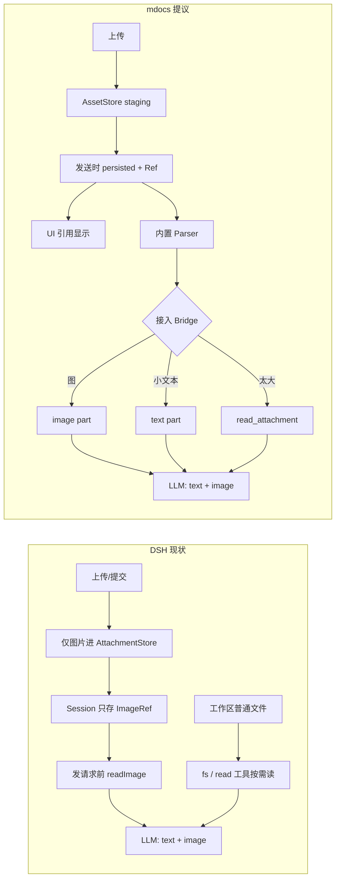
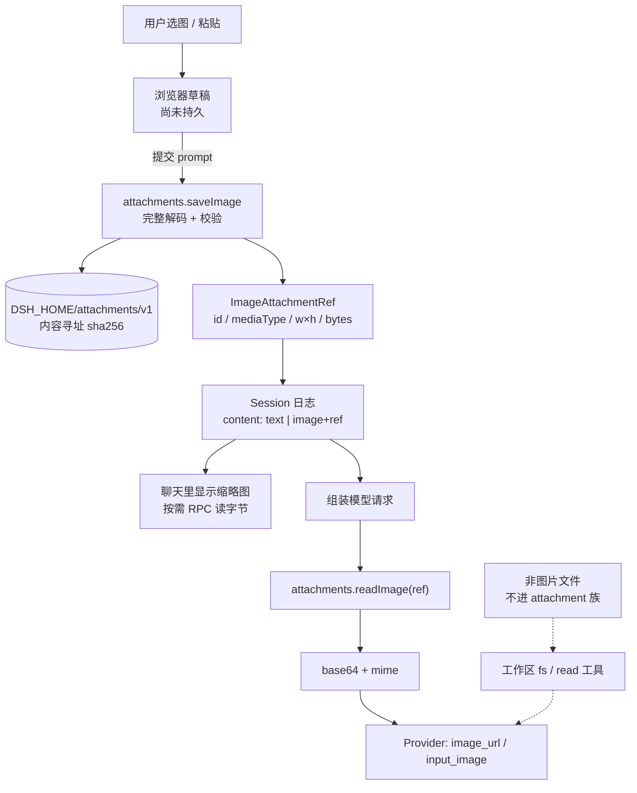
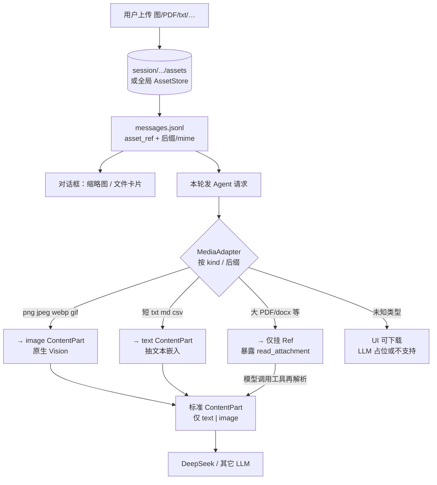
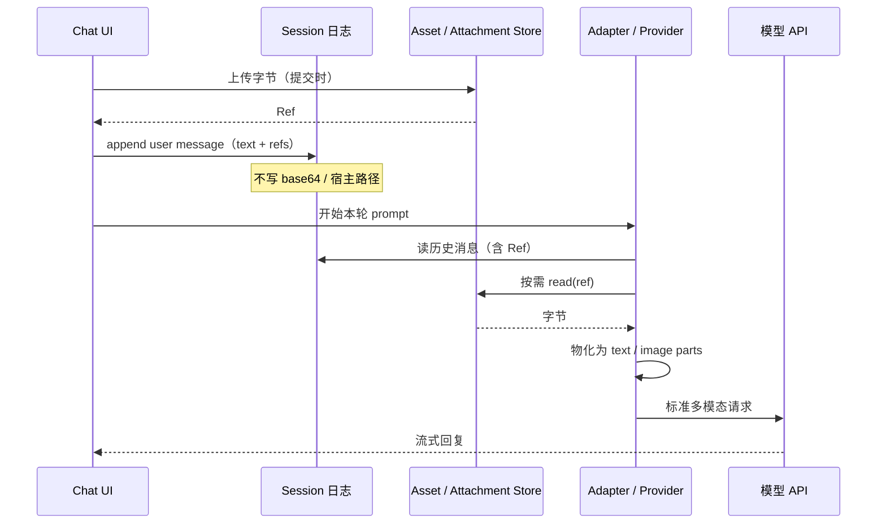

# Agent 多媒体：DSH 做法 vs mdocs 提议

> 对比 DeepSeek Harness 的 attachment 链路，与 mdocs「Asset + 解析 + 接入」设想。  
> **定稿补充**：不依赖 MarkItDown；解析在 mdocs 内置。正式契约见 [`../requirements/agent-multimedia-assets/`](../requirements/agent-multimedia-assets/)。

## 总览对比

## DSH：图片附件主路径

要点：

- **Store 只服务图片**；会话里永不写宿主路径或 raw bytes
- **发请求时才物化**；历史重放靠 Ref + `readImage`
- **PDF/docx 等**：走工具读工作区，不是「后缀处理器 → 塞进每轮 prompt」

## mdocs 提议：统一 Asset + Adapter

与 DSH 的同异：

| | DSH | mdocs 提议 |
|--|-----|------------|
| 落盘对象 | 几乎只有图 | 任意 Asset |
| 会话持久化 | Ref 元数据 | 同：只存 Ref |
| 进 LLM 前 | `readImage` → image part | Adapter → text\|image，或 tool |
| 非图文件 | fs 工具，非 attachment | Asset + 懒 tool / 抽文本 |

## 发请求时序（两边共性）

