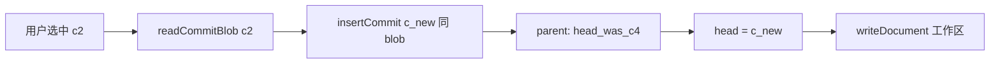

# document-version-restore — 设计契约

> **状态**：已同意（2026-10-21）  
> 依据：[`需求分析.md`](./需求分析.md)

## 方案摘要

| 项 | 约定 |
|----|------|
| 恢复语义 | 读选中 commit 的 blob → **新 commit**（`content_hash`/`blob_ref` 可与旧版相同，内容寻址去重）→ `commit_parents`：新 commit 的 parent = **恢复前 head** → 更新工作区 + `head_commit_id` |
| 不做什么 | 不把 `head_commit_id` 直接拨回旧 id；不删中间节点 |
| 列表 | `GET /documents/:id/commits`：按 `created_at DESC`，含 `commitId` / `createdAt` / `authorVisitorId`(+昵称可选) / `isHead` |
| 预览 | `GET /documents/:id/commits/:commitId`：返回该版 `content` + 元数据（权限：可读） |
| 恢复 | `POST /documents/:id/commits/:commitId/restore`（权限：可编辑）；body 可空 |
| 幂等 | 目标已是 head 且工作区 hash 已一致 → 200 原样或 `ALREADY_HEAD` 提示，不插重复节点 |
| 入口 | 文档信息菜单「版本历史」→ 面板：列表 + 预览 +「恢复此版本」确认 |
| 类型 | 有 commit 的 `md` / `html` / `sheet`；无 `head_commit_id` 的旧文：空列表或提示「尚无版本」 |
| 草稿 | 恢复成功后清该文档本地草稿冲突态（与强制覆盖类似：以服务端新 head 为准）；前端刷新 editor content |

## API

| 方法 | 路径 | 权限 | 说明 |
|------|------|------|------|
| GET | `/api/documents/:documentId/commits` | read | `{ data: CommitSummary[] }` |
| GET | `/api/documents/:documentId/commits/:commitId` | read | `{ data: { commitId, content, contentHash, createdAt, ... } }` |
| POST | `/api/documents/:documentId/commits/:commitId/restore` | edit | `{ data: DocumentDetail }` 同 get |

审计：`document.restore_version`，metadata：`fromCommitId` / `newCommitId` / `previousHeadCommitId`。

## 变更触达

| 路径 | 改动 |
|------|------|
| `commit.repo.ts` | `listCommitsByDocument` |
| `document.service.ts` | `listDocumentCommits` / `getDocumentCommit` / `restoreDocumentVersion` |
| `documents.routes.ts` | 上述三条（注意挂在 `/:documentId` 具体段） |
| `endpoints.ts` | 前端封装 |
| `DocumentEditor` / `SheetEditor` / `HtmlEditor` 或共享 `VersionHistoryPanel` | 菜单入口 + 面板 |
| i18n | 文案 |
| map / 代码索引 | 同意后更新 |

## 风险

| 风险 | 处理 |
|------|------|
| blob 缺失 | `BLOB_MISSING` 409，不可恢复该条 |
| commit 不属于该文档 | 404 |
| 恢复后本地未保存草稿 | 确认文案写明「将覆盖当前未发布草稿」；成功后删/对齐草稿 |

## 测试要点

- 两版发布 → list 长度与 isHead
- restore 旧版 → get 正文 = 旧 blob；commits 多 1 条；parent 边正确
- 已是 head → 不插新节点
- 只读访客 restore → 403

---

**请回复是否同意本设计契约。** 同意后开始实现。
