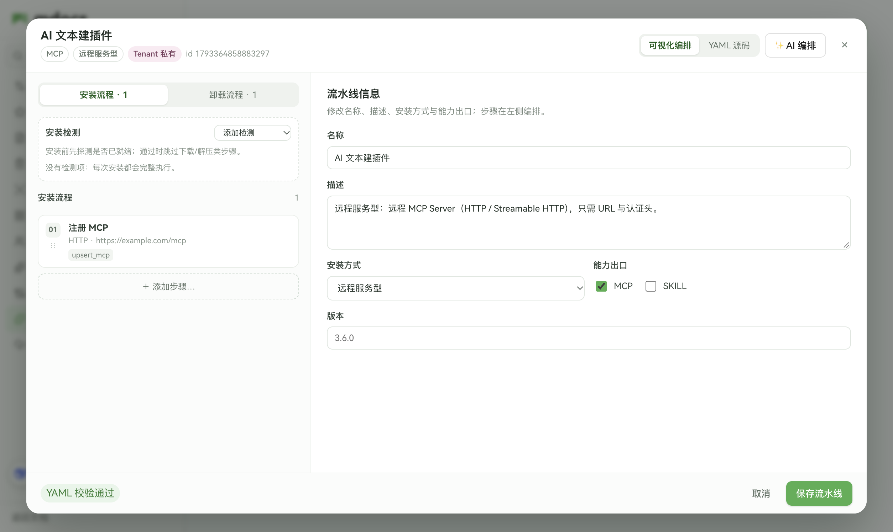
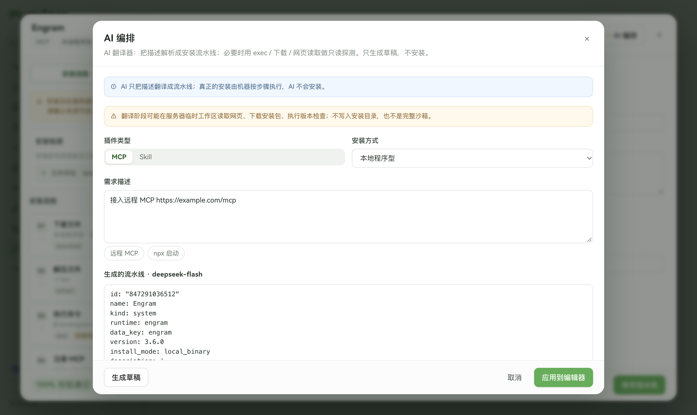

# plugin-pipeline — 增量 v2：市场 / 编排器 / 执行器 / 内嵌 AI

> **状态**：已同意 / 已实现（2026-10-30，用户本轮明确要求重做前端与安装执行）
> AI 增量：**独立流水线 Agent**（无 session、不接旧 Agent 框架），复用当前 key；工具与边界见下。
> 父契约：[设计契约.md](./设计契约.md)；v1：[设计契约-编排器UI.md](./设计契约-编排器UI.md)

## 一句话

把「YAML 编辑器」降级为高级视图；主界面是 **插件市场 + 有序步骤编排器 + 按步执行器**。流水线是资产，插件是实例。

界面证据：[插件市场](./demos/ui-market-v2.png) · [编排器](./demos/ui-orchestrator-v2.png)

## 与 v1 的差异（本轮返工）

| 问题 | v2 处理 |
|------|---------|
| 市场是一张卡片里堆列表，系统/自定义混排 | 三段式：已安装 / 可安装 / 新建；Skill·MCP 筛选；归属只做 badge |
| 编辑器只有「上移/下移 + 表单」，没有拖拽、禁用、复制、条件 | 步骤项支持拖拽、禁用、复制、条件、删除；配置区与列表分离 |
| Probe 只在 YAML 里 | Probe 独立区（不走普通步骤列表），可增删改 |
| 安装仍在跑旧 catalog（npm/engram 硬编码），不是流水线 | 新执行器逐步执行 YAML；每步状态 / 日志 / skip 原因 |
| 安装只是按钮 loading | 独立执行窗口：步骤状态、stdout/stderr、失败定位、部分安装物提示 |
| 无 AI | 内嵌**独立流水线 Agent**：复用当前 key，但不接旧 Agent 框架 / 无 session；带 exec / download / fetch 工具，只产出草稿 |

## 三维分类落地

| 维度 | 字段 | UI |
|------|------|----|
| 是什么 | `outputs: [skill\|mcp]` | 筛选 + 卡片主 badge |
| 怎么装 | `install_mode: local_binary\|command\|remote\|skill_package` | 卡片副 badge；新建向导 |
| 属于谁 | `kind: system\|user\|tenant` | 卡片来源 badge；系统可恢复初始 |

`transport: stdio\|http` 只出现在 `upsert_mcp`，不是安装方式。

## 页面结构

### 1. 插件市场

- 顶部：标题 + 说明 + 「新建插件」。
- 筛选：全部 / Skill / MCP。
- 区块：**已安装**（有 plugins.json 记录）｜**可安装**（无记录）。
- 卡片：名称、类型/安装方式/来源 badge、描述、运行态、步骤数；动作：安装 / 卸载、查看详情、编辑流水线（自定义可删除）。
- 详情弹层：元信息、安装态、运行态、存储路径（install / plugins-data / soul 旁路）、步骤摘要、安装历史、安装/卸载。
- 新建向导：Skill / MCP → 安装方式 → 名称 →（可选）一句话描述 → 生成起步流水线并进入编排器。


- 描述可选走 AI：创建后服务端把描述翻译成 YAML、保存，再打开编排器；失败则保留起步模板并提示。AI 仍只翻译，安装要另点。

### 2. 编排器（全屏弹层）

```
┌ 返回 · 名称 · badges · 未保存 ● ── 可视化 | YAML ── AI 编排 ┐
├ 安装流程 | 卸载流程                          [风险提示]   ┤
├ 左：Probe 独立区 + 步骤列表（拖拽/禁用/复制）  右：步骤表单 ┤
└ 校验状态 · 恢复初始 · 取消 · 保存                          ┘
```

- 列表 = `steps` / `uninstall` 数组；拖拽重排，序号实时刷新。
- 表单由 `GET /step-definitions` 的 fields 渲染；`upsert_mcp` 仍用 schema 的 `visibleWhen` 切 command/url。
- 条件 `when: always|first_install|probe_passed|probe_failed`；`skip_on_probe` 控制二次安装跳过。
- 可视化 ↔ YAML 共享 AST；切回可视化先 parse，失败则留在 YAML 并报错；关闭前未保存确认。
- 系统流水线：恢复初始（`.default`）；自定义：删除。

### 3. 安装执行器

- 由「安装」触发，打开执行窗口；轮询 `GET /pipelines/:scope/:id/job`。
- 每步状态：pending / running / done / skipped / error；skipped 标注 `probe` 原因。
- 聚合日志（带步骤序号）+ 失败步骤错误；结束后可关闭/重试。
- 固定风险文案：本机执行、非沙箱；展示下载来源与 exec 命令摘要。
- 失败时提示「可能已产生部分安装物」，并展示 install 目录。

## 底层：执行器语义

| 步骤 | 行为 |
|------|------|
| download | URL 模板 → `install/<id>/pkg/`；空 URL + runtime=engram 用镜像候选；可 sha256 |
| extract | 解压 pkg 内压缩包到 `dest`（默认 install 根） |
| copy_file | install 根内文件复制 |
| exec | 命令解析（相对 install 根/递归找可执行）、cwd/env、超时、输出流 |
| upsert_mcp | id=`plugin-<pipeline.id>`；stdio 解析真实 command；http 写 url/headers |
| upsert_skill | 写 `agent_user_skills`（当前访客） |
| write/delete_soul_sidecar | `soul/` 或 tenant soul；禁路径穿越 |
| remove_mcp / remove_skill | 卸载 |

模板变量：`{{install_root}}` `{{plugins_data}}` `{{version}}` `{{goos}}` `{{goarch}}` `{{visitor_id}}` `{{plugin_id}}`。

Probe 通过时，`skip_on_probe`（默认 download/extract/copy_file）步骤标记 skipped；`when` 条件同样据此判断。

安装成功写 `plugins.json`（含 pipelineId/runtime/mcpServerId/时间/历史）；卸载执行 uninstall 后删安装目录，保留 `plugins-data`。

## 内嵌 AI：独立流水线 Agent



### 职责边界（重要）

| 角色 | 负责 | 不负责 |
|------|------|--------|
| AI 翻译器 | 把自然语言翻译成 `pipeline.yaml`；必要时做只读探测 | 不安装、不写安装目录、不启动服务、不调用安装接口 |
| 机器执行器 | 用户点「安装」后按 YAML 逐步 download / extract / exec / 写 MCP / soul | 不理解自然语言 |

- AI 入口只返回 YAML 草稿；用户必须再点「应用到编辑器 → 保存 → 安装」。AI 端点不 import 执行器。
- 探测工具只在临时工作区，安装命令（npm/pnpm/pip/brew…）在探测阶段被拒；最终 `exec` 步骤仍由执行器在用户确认后运行。

- 入口：编排器顶部「AI 编排」（改当前流水线），以及新建向导里的「用 AI 描述」（文本 → 新流水线）。**不经过** mdocs 智能助手会话；**不接** 旧 Agent 模型 / 工具注册表 / session。
- 只复用当前访客默认模型配置的 baseUrl / key / model（`getVisitorAgentConfig`），每次请求独立、无历史。
- 工具（临时工作区，任务结束即删除）：
  | 工具 | 用途 | 边界 |
  |------|------|------|
  | `exec` | 验证 npx/node/tar、看压缩包、跑 `--version` | 无 shell；禁 sudo/rm/sh 等；1–30s；cwd 限临时工作区 |
  | `download` | 下载安装包到临时工作区 | 仅公开 http(s)；≤50MB；禁内网/本机；重定向逐跳校验 |
  | `fetch_page` | 读 README / release / MCP 文档 | 公开 http(s)；转纯文本 ≤12k；禁内网/本机 |
  | `list_dir` / `read_file` | 检查下载物 | 仅临时工作区；禁路径穿越 |
  | `submit_pipeline` | 提交最终 YAML | 服务端 schema 校验；失败会把错误回给模型重试 |
- 循环：最多 8 次工具调用 / 10 轮；总预算 150s；OpenAI 兼容与 Anthropic messages 都支持 tool calling。
- 输出：YAML 草稿 + 校验结果 + **工具调用 trace** + notes；只生成，不保存/安装。
- 约束：编辑器内只能改**当前流水线**（id/kind 必须一致）；AI 想「新建插件」会被 submit_pipeline 拒绝，提示用户走新建向导，避免误覆盖系统插件。
- 无模型配置时提示先去「智能助手 → 模型配置」。
- 风险：模型仍可能生成危险 exec / 任意 URL；应用前展示 YAML、trace 与风险提示，执行仍需人工安装。

## 一期优先级

| 优先级 | 功能 | 本轮 |
|--------|------|------|
| P0 | 市场分类 / 已安装与可安装分区 / 详情 / 新建向导 | ✅ |
| P0 | 可视化步骤（拖拽、禁用、复制、条件）+ Schema 表单 | ✅ |
| P0 | Probe 独立区；安装/卸载双流程 | ✅ |
| P0 | YAML 解析校验保存；系统恢复初始；未保存提示 | ✅ |
| P0 | 流水线执行器 + 按步状态 + 日志 | ✅ |
| P1 | 内嵌独立 AI Agent（exec / download / fetch / submit） | ✅ |
| P1 | 安装历史 / 存储区 / 风险披露 | ✅ |
| P2 | 步骤模板库、导入导出、YAML diff | 后续 |

## 非目标

- 自由画布连线；Agent 自动生成并直接执行；假装沙箱；多租户管理员权限模型。

## 实现补充（2026-10-30 落地时确定）

| 点 | 实现 |
|----|------|
| 未写 uninstall | 执行器按安装步骤反推：`write_soul_sidecar` → `delete_soul_sidecar`；`upsert_skill` → `remove_skill`；有 `upsert_mcp` → `remove_mcp`。避免旧自定义流水线无法卸载。 |
| Engram MCP id | 固定 `plugin-engram`（`upsert_mcp.mcp_server_id`），卸载同一 id，避免迁移后删不到。新建插件默认仍是 `plugin-<pipeline.id>`。 |
| 旧 Engram 路径 | 启动/首次读取市场时，把 `plugins/engram/bin/engram` 一次性搬到 `plugins/install/847291036512/bin/`，修正 MCP command，补 `plugins.json.pipelines`，删旧目录。 |
| AI 草稿归一 | 模型常把 `kind` 写成 mcp/skill；服务端强制 `kind` 为当前流水线的 kind（新草稿 tenant）、沿用当前 id、缺失 outputs 时按步骤推断、丢弃 `remove_mcp` 的显示名 id。 |
| AI 只翻译 | AI 模块不 import `runPipeline` / `startPipelineJob`；交卷只出草稿（`pipeline_draft`）。安装由用户点「安装」后执行器完成。探测 `exec` 会拒绝 npm/pnpm/pip/brew 等安装命令。 |
| Probe 通过 | `skip_on_probe` 默认对 download/extract/copy_file 生效；`when` 支持 always/first_install/probe_passed/probe_failed。 |
| 卸载失败 | 保留安装态记录（不只写失败历史），避免 UI 假装已卸载。 |
| 安装失败 | 保留安装目录，执行窗提示“可能留下部分安装物”；不自动回滚。 |
| 测试 | `executor.test.ts` 覆盖 MCP+soul 安装、Probe 跳过、卸载清理、兜底卸载；Engram 实机全流程（download→extract→init→MCP→soul）已验证。 |
