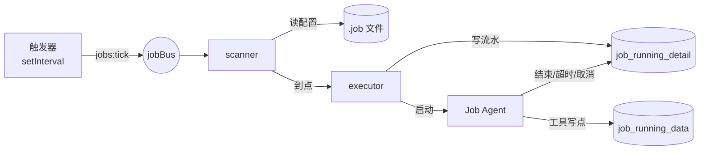
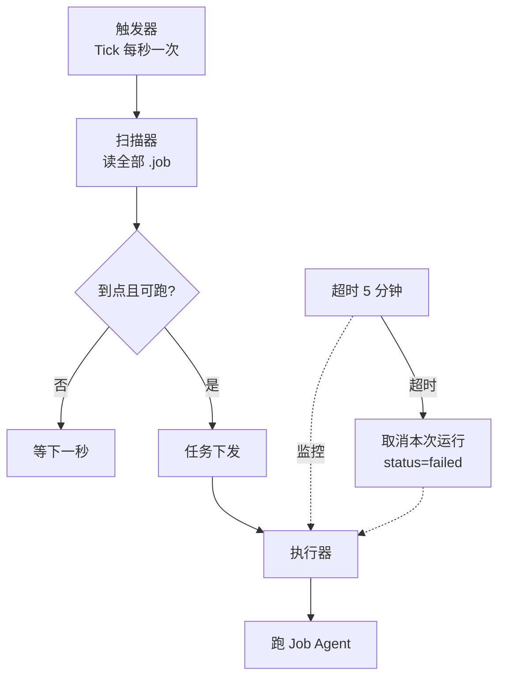

# scheduled-jobs — 设计契约

> **状态**：已同意（2026-11-05）— 分步实现，每步停 review  
> 实现增量可继续改本契约。

## 方案摘要

把产品「定时跑任务 → 落表/看图 → 看运行情况」落成系统：`.job` 存人改的配置；SQLite 存运行 Log 与 Agent 产出；进程内 watchdog 按秒级 cron 触发 Job Agent。

### 产品功能落点

| 产品能力 | 一期 | 说明 |
|----------|------|------|
| 创建/打开 Job 面板（配置 / 图 / 运行） | 做 | 文档类型 `.job` |
| cron 定时触发 | 做 | 6 段秒级 cron |
| 智能助手型任务（prompt → 查数 → 落表） | 做 | Job 专用 Agent + `job_append_data` |
| 产出表 + 图表展示 | 做 | `job_running_data` |
| 运行 Log、失败原因、超时 5 分钟 | 做 | `job_running_detail` |
| 手动执行 / 手动终止 | 做 | 与 cron 共用 executor |
| 监控规则配置（阈值表单） | 只存 | 写入 `.job` 的 `MonitorConfig` |
| 监控求值 + 站内信/邮箱通知 | **不做** | 二期；本方案不实现通知链路 |

### 数据归属

| 数据 | 存储 |
|------|------|
| Job 配置 + 监控规则配置 | `.job` 文件（JSON） |
| 运行 Log | SQLite `job_running_detail` |
| Agent 产出（表） | SQLite `job_running_data` |

`job_id === document_id`。

### 整体架构



配置与产出分存，避免前台改配置盖掉后台写数。一期无告警下游。  
调度解耦：进程内 `EventEmitter`（`jobBus`）只发 `jobs:tick`；scanner 订阅，不引入第三方 bus。

---

## `.job` 文件

与 md / html / sheet 同级；后缀 `.job`；无草稿 / 发布 / merge / 版本；多人改配置后写覆盖。  
删文档或迁路径时：处理 `.job` 文件，并按 `job_id` 清理两张运行时表。

```json
{
  "JobConfig": {
    "jobId": "",
    "jobType": "agent",
    "cron": "0 0 9 * * *",
    "prompt": "",
    "tableSchema": { "x": "时间", "y": "价格" }
  },
  "MonitorConfig": [
    {
      "monitorId": "",
      "rule": "<=",
      "threshold": 0
    }
  ]
}
```

- `cron`：6 段（`秒 分 时 日 月 周`），库须支持秒。
- `tableSchema`：轴含义；与 `job_running_data.x/y` 对应。
- `MonitorConfig`：一期只读写文件，不求值、不通知。

---

## SQLite 表

### `job_running_detail`

| 列 | 说明 |
|----|------|
| `id` | 主键；即 `job_running_id`，注入 Agent |
| `job_id` | `document_id` |
| `status` | `0 prepare` / `10 running` / `20 done` / `30 failed` |
| `start_time` / `end_time` | 起止；结束可空 |
| `failed_reason` | 失败原因，可空 |
| `trigger` | `cron` \| `manual` |

一条 detail 对应多条 data（`job_running_id`）。

### `job_running_data`

| 列 | 说明 |
|----|------|
| `id` | 主键 |
| `job_id` | `document_id` |
| `job_running_id` | → `job_running_detail.id` |
| `x` | 横轴值 |
| `y` | 纵轴数值 |
| `created_at` | 写入时间 |

---

## watchdog



1. 启动时 `setInterval(1000)`；scan 与 executor **异步解耦**，执行慢不堵下一秒扫描。
2. 入队条件（同时满足）：
   - 当前秒匹配 cron；
   - 该 job **本秒尚未**写过 `job_running_detail`（同秒只一次）；
   - 该 job **没有** `prepare/running`（上一轮未完则跳过）。
3. 启动前插入 detail → `running`，`id` 交给 Agent。
4. 超时：运行层 Abort/取消（不假设 OS kill），`failed` + 原因；之后拒绝该 id 写数。
5. 正常结束：`done`。
6. **一期不做**执行资源池/限流。

### 手动执行 / 终止

- 立刻执行：同一 executor，`trigger=manual`；已有未完成 → **拒绝**。
- 终止：取消 Agent，`failed`（用户取消）。

---

## Job Agent

- 不复用聊天助手；一期无 session。
- 身份：文档 **owner visitor**。
- 注入：`job_id`、`job_running_id`、`tableSchema`、`prompt`。
- 工具：
  1. 联网：`fetch_web` / `search_web`（以现网名为准）
  2. **`job_append_data`**：`points: { x: string, y: number }[]`；`job_running_id` 由运行时绑定；可多次调用
- 禁止改文档、改他人 job、裸 SQL。

---

## 前端

- 创建类型增加 Job；打开为操作面板。
- 配置｜数据图｜运行列表（含手动执行/终止、失败原因）。
- 监控规则可编辑进文件；无告警发送 UI。

---

## 变更触达

| 区域 | 说明 |
|------|------|
| `file-types` / `file-type-policy` | `job` + `.job` 政策（无 merge/草稿） |
| documents / storage | 读写删 `.job`；删时清运行时表 |
| `db/schema` | 两张运行时表 |
| `server/jobs/`（名可调） | watchdog、executor、cron、超时取消 |
| Job Agent | `job_append_data` + 精简工具 |
| 前端 Job 面板 + API | 配置/图/流水/manual/cancel |

## 风险与回滚

| 风险 | 应对 |
|------|------|
| 每秒读全量 `.job` | 一期接受 |
| 取消不彻底 | Abort + 拒绝超时后写数 |
| cron 过频 | 未完成跳过；不做复杂限流 |
| 回滚 | 忽略 `.job` 类型；表可留 |

## 测试要点

- 匹配秒只一条 detail；运行中再触发不双开。
- 超时 / 手动取消 → `failed`，写数被拒。
- `job_append_data` 只写当前 run；删 Job 两表无残留。
- 保存配置不删已有 `job_running_data`。
