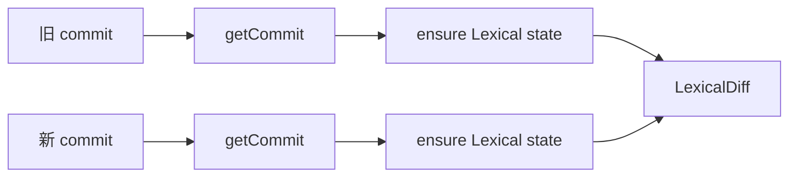

# version-history-compare-fullscreen — 设计契约

> **状态**：已同意（2026-10-28）  
> 依据：[`需求分析.md`](./需求分析.md)  
> **更正（用户）**：Diff 组件用 `@lobehub/editor/renderer` 的 **`LexicalDiff`**，不用 `@lobehub/ui` 的 `CodeDiff`。

## 结论先说

| 问题 | 约定 |
|------|------|
| 用哪个 Diff？ | **`import { LexicalDiff } from '@lobehub/editor/renderer'`**（`oldValue` / `newValue` 均为 `SerializedEditorState`）。项目里 `LexicalLinesReview` 已用同包的 `computeLexicalDiffRows`。 |
| 不用什么？ | 不用 live Editor 的 DiffHunk Accept/Reject；不用 `CodeDiff`（除非非 md 降级，见下）。 |
| 要不要新 API？ | **不要**。两次 `getDocumentCommitApi`。 |
| 全屏 | 对话框 `is-fullscreen` ≈ `100vw × 100dvh`；不用浏览器 Fullscreen API。 |

## 对比输入（关键）

`LexicalDiff` **只吃 Lexical JSON**，不吃 Markdown 字符串。

| fileType | 对比 |
|----------|------|
| **md** | 主路径。commit blob → 若已是 Lexical JSON 则 `JSON.parse`；若是 Markdown（旧数据）则 `convertContentApi({ from: 'markdown', to: 'lexical' })` 再 parse → 喂给 `LexicalDiff`。 |
| **html / sheet** | **一期不做 LexicalDiff**（状态非 Lexical）。对比入口可灰掉并提示「仅 Markdown 文档支持块级对比」，或后续另议文本 diff。 |

解析失败：右侧错误文案，不挂组件。

## UI

### 头栏

```
版本历史          [预览|对比]  [全屏/退出全屏]  [关闭]
隐藏自动发布 …
```

- **预览**：现行为（单选 + 只读预览 + 恢复）。
- **对比**：双选；底栏恢复隐藏/禁用。
- **全屏**：class 切换；全屏时点遮罩不关，须点关闭（减少误关）。

### 双选（同前）

列表每行 **旧** / **新** 芯片：

- 点「旧」→ `oldCommitId`；点「新」→ `newCommitId`
- 同一 id：拒绝或互换，并提示「请选两个不同版本」
- 行样式：`is-old` / `is-new`

右侧：

- 缺一侧：占位「请选择旧版本 / 新版本」
- 两侧就绪且均为合法 `SerializedEditorState`：

```tsx
<LexicalDiff
  oldValue={oldState}
  newValue={newState}
  labels={{
    old: <旧版时间/message>,
    new: <新版时间/message>,
  }}
/>
```

- 组件 **lazy** 引入（`@lobehub/editor/renderer`），避免版本历史未开时拖进首屏。
- 双拉 commit + 必要时 markdown→lexical **并行**；busy 时保留上一帧或角标 loading（承袭现 preview busy）。



### 全屏布局

| 态 | 对话框 |
|----|--------|
| 默认 | 现 `min(960px, 96vw)` |
| 全屏 | `100vw × 100dvh`，去圆角；列表+Diff 区 `flex:1` |

## 变更触达

| 路径 | 改动 |
|------|------|
| `VersionHistoryPanel.tsx` | 模式 / 双选 / lazy `LexicalDiff` / 全屏；md 规范化 helper |
| `App.css` | fullscreen、对比行徽章、Diff 容器滚动 |
| i18n | 对比、旧/新、全屏、仅 md 提示 |
| `map/frontend.md` + 本需求代码索引 | 同意后 |

## 风险

| 风险 | 处理 |
|------|------|
| blob 缺插件节点 / 空 root | 与现预览一致：失败提示；不挂第二套 live Editor |
| 大文档 LCS 卡顿 | 仅对比态计算；可后续 worker（一期不做） |
| html/sheet 用户点对比 | 明确不可用，不静默空 diff |

## 测试要点

- 两版 md Lexical → `LexicalDiff` 有 insert/delete/modify 行
- 一侧为 markdown 字符串 blob → 转换后仍能对比
- 同 commit 不能成对
- 预览/对比/全屏切换不丢列表；恢复仅在预览态

---

**请回复是否同意本设计契约。** 同意后开始实现 UI。
