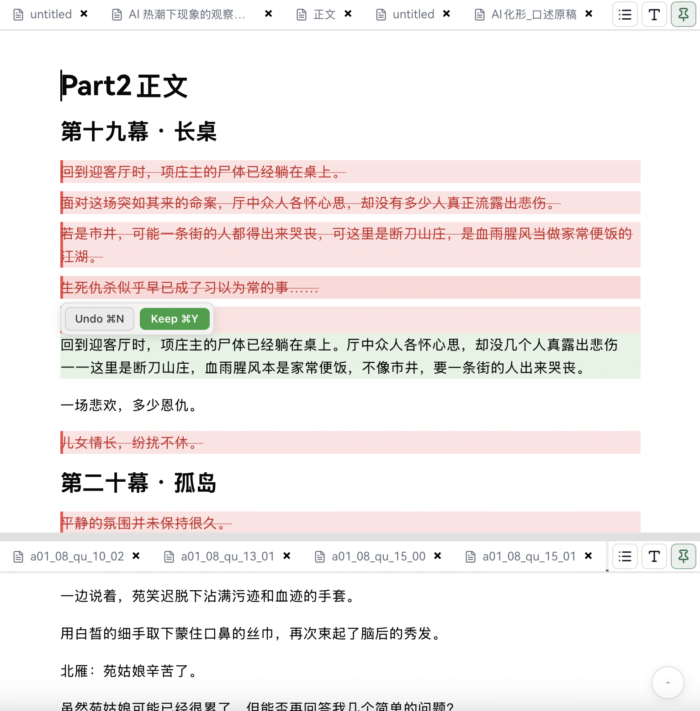
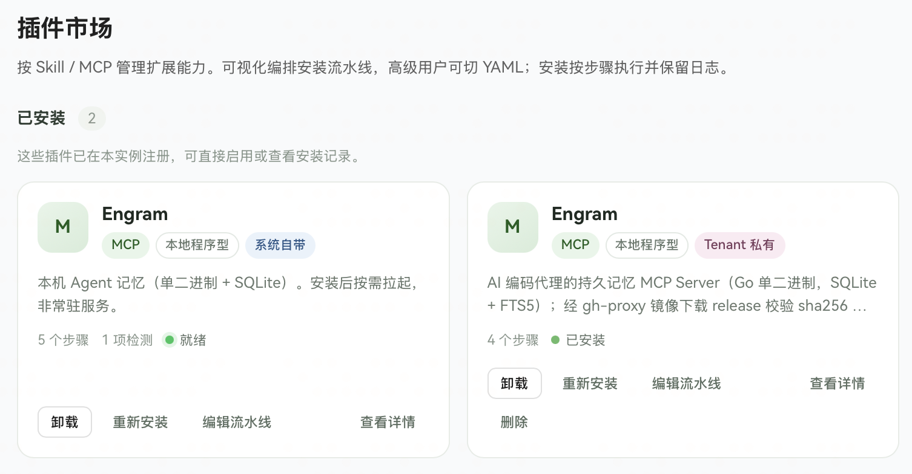
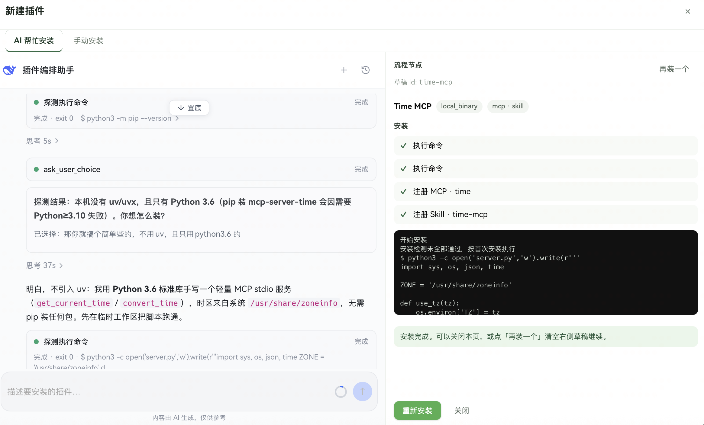

# mdocs

**专门为 Markdown 设计的 Agent 工作台。**

[文档站点](https://xuhuafeifei.github.io/mdocs-site/) · [GitHub](https://github.com/xuhuafeifei/mdocs) · [npm `@fgbg/mdocs`](https://www.npmjs.com/package/@fgbg/mdocs) · 当前版本 **3.1.16**

## 为什么选 mdocs

| 能力 | 说明 |
|------|------|
| **所见即所得** | 直接编辑渲染后的 Markdown，不必在源码和预览之间来回跳。 |
| **Markdown inline Diff** | Agent 改稿与版本对比都在渲染态上按块 Keep / Undo，不是 IDE 源码 diff。 |
| **Agent 代劳** | 搜文、建文档、改结构、写作审阅都可交给 Agent；可挂 **Engram** 本机记忆。 |
| **内置版本 + 预览对比** | 发布即留历史，预览 / 对比旧稿；数据默认 `~/.mdocs`。 |
| **流水线：MCP + Skills / CLI** | 插件挂 MCP；[mdocs-cli](https://github.com/xuhuafeifei/mdocs-cli) Skills 让 Cursor / Claude 读写同一知识库。 |

## 快速开始

```bash
npm install -g @fgbg/mdocs
mdocs
# 浏览器打开 http://localhost:4000
```

临时体验：

```bash
npx @fgbg/mdocs
```

需要 **Node.js 22+**。更细的安装见 [文档 · 安装](https://xuhuafeifei.github.io/mdocs-site/docs/getting-started/installation.html)。

## 能力一览

### 所见即所得

<p align="center">
  
</p>

### Markdown inline Diff

Agent 提案写进当前打开的编辑器，在**渲染态**上显示红绿 Diff；按块 Keep / Undo 后再发布。

<p align="center">
  
</p>

### Agent 代劳

搜文、建文档、改结构、写作与审阅——产品内能力都可以交给 Agent。

<p align="center">
  
</p>

### 内置版本 + 预览对比

<p align="center">
  
</p>

### 流水线：MCP + Skills / CLI

插件市场管理 Skill / MCP；安装流水线可视化编排。

<p align="center">
  
  
  
</p>

CLI Token + Skills：Cursor / Claude 可搜索、读写同一知识库。详见 [Agent 开发闭环](https://xuhuafeifei.github.io/mdocs-site/docs/usage/agent-dev-loop.html) · [CLI Token](https://xuhuafeifei.github.io/mdocs-site/docs/usage/cli-token.html)。

## 从源码开发

```bash
git clone https://github.com/xuhuafeifei/mdocs.git
cd mdocs
pnpm install
pnpm dev          # API :4000 + Vite :5173（代理 /api）
```

```bash
pnpm build && pnpm start   # 生产：同端口提供静态资源与 API
pnpm test
pnpm typecheck
pnpm mdocs visitor list    # 管理 CLI（开发用 tsx 入口）
```

全局安装后原地升级（淘宝 npmmirror，保留 `node_modules`）：

```bash
mdocs update
```

仓库布局：

```
src/
  server/    Express API、Agent、文档与工作空间、CLI
  web/       Vite + React 前端
  shared/    两侧共用类型与路径工具
```

## 运行时数据

默认目录 `~/.mdocs/`（可用 `MDOCS_DATA_DIR` 覆盖）：

```
~/.mdocs/
  sqlite/data.sqlite
  files/docs/          # 文档内容
  files/assets/        # 附件
  logs/
```

`domain_id` 只存在于 SQLite，**不会**出现在文件路径里。

## 访客身份与迁移

首次访问输入昵称 → 获得 `visitor_id` + 高熵 token；浏览器存明文，服务端只存 `SHA-256(token)`，请求头 `x-visitor-token`。

清缓存后重新注册可用迁移合并身份：

```bash
mdocs visitor migrate --from Alice --to Bob --dry-run
mdocs visitor migrate --from Alice --to Bob --confirm
```

## 上传图片资源（CLI）

```bash
mdocs asset upload ./shot.png
# → http://localhost:4000/api/assets/<uuid>.png
mdocs asset upload ./a.png ./b.svg --base-url https://docs.example.com --json
```

命名规则与网页上传一致，落到 `<数据目录>/files/assets/`，经 `GET /api/assets/:id` 访问。

## 相关链接

| | |
|--|--|
| 产品文档 | https://xuhuafeifei.github.io/mdocs-site/ |
| 文档源码站 | https://github.com/xuhuafeifei/mdocs-site |
| CLI / Skills | https://github.com/xuhuafeifei/mdocs-cli |
| 问题反馈 | https://github.com/xuhuafeifei/mdocs/issues |

## License

[MIT](./LICENSE)
